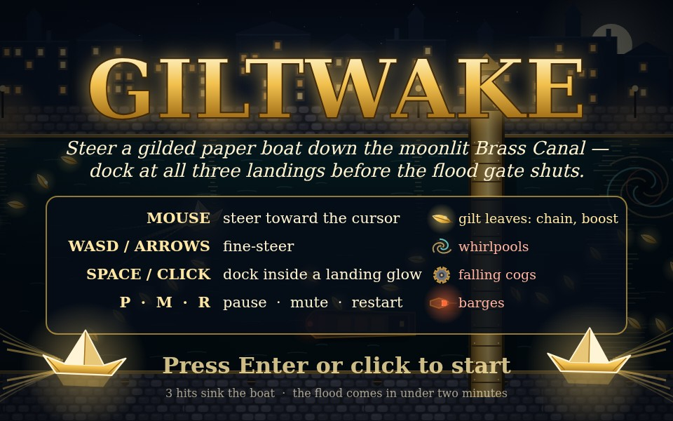

# Giltwake

[](https://make.fun/bounty/best-game-01)
[](https://make.fun/bounty/best-game-01)
[](https://make.fun/bounty/best-game-01)

An entry for the make.fun bounty [Make the best game (best-game-01)](https://make.fun/bounty/best-game-01).

Steer a small gilded paper boat down the moonlit Brass Canal. The current carries you forward;
dock at all three landings before the flood gate shuts.



## Play

```sh
node serve.ts            # then open http://127.0.0.1:8080/
node serve.ts --port 8765
```

No build step and no network: `game/index.html` and its ES modules are the whole game. All
art is drawn on a canvas and all sound is synthesized with Web Audio.

| Control | Action |
| --- | --- |
| Mouse | the boat steers toward the cursor, with gentle inertia |
| WASD / arrow keys | fine-steer |
| Space / click | dock while inside a landing's glow |
| Enter / click | start from the title |
| P | pause |
| M | mute |
| R | restart (on every screen) |

**Rules.** Three canal stretches, each ending at a landing. Gilt leaves score points times your
leaf chain (catch the next one within a few seconds to keep it) and give a short speed boost.
Whirlpools, passing barges, and cogs falling from the clock-bridges each crack the hull; three
cracks sink the boat. If the flood timer runs out first, the canal takes the gilt. Dock at the
third landing to win, with bonuses for time left and hull intact. Every stretch is longer and
faster than the one before, with more traffic and more cogs.

`?seed=N` replays the same canal. `?shot=title|play|won|lost&seed=1` restages the real game,
frozen, for screenshots (see `shots.json`).

## Repository

```
game/index.html        canvas page
game/src/main.js       screens, fixed-step loop, input wiring, shot bootstrap
game/src/config.js     palette, layout and tuning
game/src/input.js      keyboard and mouse
game/src/boat.js       steering, hull, wake
game/src/world.js      canal stretches, landings, hazards, leaves, scoring, win/lose rules
game/src/render.js     all drawing: scene, HUD, title/pause/win/lose screens
game/src/audio.js      Web Audio: water, dock bell, leaf chime, title motif, flood drone
game/src/shots.js      stageShot(name, seed) for the screenshot queries
game/src/random.js     seeded RNG
main.ts                hands the entry in: copies game/ and screenshots/, writes dossier.json
serve.ts               tiny local static server
shots.json             screenshot names and queries
screenshots/           four real frames of the game
vendor/makefun-game.ts make.fun's kit library, unchanged
```

Hand-in (Node 22+, standard library only):

```sh
mkdir -p out && MAKEFUN_OUTPUT_DIR=out node main.ts
```

## License

MIT, see [LICENSE](LICENSE).
